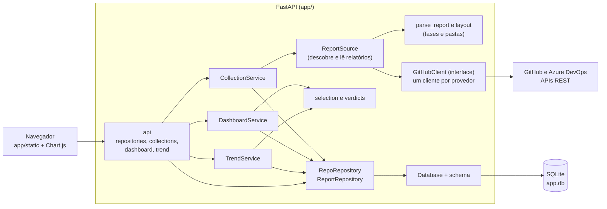

# Dashboard de atividades por fase

MVP web, em Python, que consolida o andamento de projetos a partir de relatórios de validação guardados em repositórios GitHub ou Azure DevOps. Para cada repositório cadastrado, ele lê os relatórios `*.md` das cinco fases do projeto, interpreta `generated` e `verdict` e mostra quantas features estão em cada veredito, por fase, em gráficos de barras empilhadas horizontais. Também mostra a evolução semanal desses números.

- **Escopo, requisitos e fora de escopo:** [docs/01 escopo-mvp.md](docs/01%20escopo-mvp.md)
- **Backlog por release:** [docs/02 backlog.md](docs/02%20backlog.md)
- **Diagrama de componentes e fluxos:** [docs/03 diagrama-componentes.md](docs/03%20diagrama-componentes.md)
- **Revisão de planejamento e riscos:** [docs/05 revisão de planejamento.md](docs/05%20revis%C3%A3o%20de%20planejamento.md)

## Sumário

1. [Funcionalidades](#funcionalidades)
2. [Instalação](#instalação)
3. [Execução](#execução)
4. [Como o dashboard lê os relatórios](#como-o-dashboard-lê-os-relatórios)
5. [API](#api)
6. [Testes](#testes)
7. [Arquitetura](#arquitetura)
8. [Uso da IA](#uso-da-ia)
9. [Limitações](#limitações)
10. [Próximos passos](#próximos-passos)

## Funcionalidades

- Cadastro de repositórios em tempo de execução, com branch opcional: `owner/repo` ou URL do GitHub, ou URL do Azure DevOps (`https://dev.azure.com/org/projeto/_git/repo`). O mesmo repositório pode ser cadastrado uma vez por branch.
- Coleta dos relatórios das fases Requirements, FSpec, DSpec, Code e Tests.
- **Um gráfico por repositório**, com o total de features por fase e veredito, e a opção **Ver como tabela**.
- **Ver como tendência**: linhas empilhadas com a evolução semanal das features por veredito, para a fase escolhida (padrão: Tests). Todos os gráficos usam as mesmas datas no eixo horizontal.
- **Atualizar** em cada painel: só coleta se o último commit do branch for diferente do último coletado; o commit lido aparece no painel.
- Tema claro e escuro, com a escolha salva no navegador.
- Dois repositórios de exemplo já cadastrados no primeiro uso (veja [Execução](#execução)).

## Instalação

Requisitos: **Python 3.11 ou superior** (desenvolvido e testado com 3.12, em Windows 11) e acesso à internet (GitHub e Chart.js).

```powershell
git clone <url-deste-repositório>
cd akcit_modulo_4

py -3.12 -m venv .venv
.venv\Scripts\Activate.ps1
pip install -r requirements.txt
```

Dependências de execução: `pydantic`, `fastapi` e `uvicorn`. O acesso ao GitHub e ao banco usa só a biblioteca padrão (`urllib` e `sqlite3`).

## Execução

```powershell
# Tokens: pela interface (engrenagem → "Tokens de acesso") ou, se preferir, por variáveis de ambiente:
$env:GITHUB_TOKEN = "<token de leitura>"          # opcional para repositórios públicos do GitHub
$env:AZURE_DEVOPS_TOKEN = "<PAT com Code: Read>"   # necessário para repositórios do Azure DevOps
uvicorn app.main:create_app --factory
```

Abra <http://127.0.0.1:8000>. A documentação interativa da API fica em <http://127.0.0.1:8000/docs>.

**Primeiro uso.** Quando o banco é criado, a aplicação cadastra `joaogoes/akcit_modulo_4_repo` nos branches `projeto-1` e `projeto-2`, com dados fictícios (35 features e 100% concluído em 6 meses; 104 features e 86% concluído em 9 meses). Clique na engrenagem e em **Coletar todos** para ver os gráficos. Remover um exemplo não o recria; para voltar ao estado inicial, apague o `app.db`.

**Configuração**

| Variável | Padrão | Uso |
|---|---|---|
| `GITHUB_TOKEN` | — | Token de leitura. Necessário para repositórios privados do GitHub. Vale só se não houver token salvo no banco. |
| `AZURE_DEVOPS_TOKEN` | — | Token de acesso pessoal (PAT) com permissão `Code: Read`. Necessário para repositórios do Azure DevOps privados. Vale só se não houver token salvo no banco. |
| `DATABASE_PATH` | `app.db` | Arquivo do banco SQLite. |

**Tokens salvos pela interface.** Na janela da engrenagem, a seção *Tokens de acesso* guarda **um token por provedor** (GitHub e Azure DevOps). No Windows, o token é cifrado com o DPAPI antes de ir para o banco: só o mesmo usuário do Windows, na mesma máquina, consegue lê-lo, e copiar o `app.db` para outro lugar não revela nada. A tela mostra apenas se há token e de onde ele vem, e nunca o valor. O token salvo vale já na próxima coleta, sem reiniciar, e tem prioridade sobre as variáveis de ambiente; **Remover** apaga o do banco e devolve a vez à variável de ambiente, se existir. Fora do Windows não há armazenamento protegido, então salvar é recusado e valem só as variáveis de ambiente. Se o banco for movido para outra máquina ou usuário, o token salvo deixa de ser legível e a aplicação pede para salvá-lo de novo.

**Token e limite de requisições.** Sem token, só repositórios públicos funcionam: a árvore de arquivos vem da API (1 chamada por coleta; limite de 60 por hora por IP) e o conteúdo, de `raw.githubusercontent.com`, fora dessa cota. Com token, cada arquivo é lido pela API (5.000 por hora): coletar o `projeto-2` consome cerca de 600 requisições. Para criar um token, use um *fine-grained token* com acesso somente leitura aos repositórios (para repositórios públicos, nenhuma permissão extra). Nunca grave o token em arquivos do projeto.

**Azure DevOps.** Cole a URL do repositório no cadastro, por exemplo `https://mondry-tech@dev.azure.com/mondry-tech/Note5/_git/Note5` (com ou sem o usuário na frente). O nome é guardado como `organização/projeto/repositório`, e a lista mostra o provedor de cada repositório. Para gerar o PAT: Azure DevOps → *User settings* → *Personal access tokens* → *New token*, com o escopo **Code (Read)**. Sem token, o serviço redireciona para a página de login, e a coleta falha com uma mensagem pedindo o token (salve-o na engrenagem ou defina `AZURE_DEVOPS_TOKEN`). Com um token recusado (expirado, sem `Code: Read` ou de outra organização), a mensagem diz isso.

## Como o dashboard lê os relatórios

Cada repositório, do GitHub ou do Azure DevOps, deve seguir esta estrutura (caminhos com `/`, na raiz do branch):

| Fase | Pasta dos relatórios |
|---|---|
| Requirements | `200 Requirements/230 Output/<feature>/reports/req-validation/*.md` |
| FSpec | `300 Specs/320 F-Specs/Output/<feature>/reports/fspec-validation/*.md` |
| DSpec | `300 Specs/330 D-Specs/Output/<feature>/reports/dspec-validation/*.md` |
| Code | `400 Code/Output/<feature>/reports/code-validation/*.md` |
| Tests | `500 Tests/Output/<feature>/reports/code-tests/*.md` |

Cada relatório precisa de duas linhas, no front matter ou no corpo:

```markdown
---
generated: 2026-10-10T14:30:00Z
verdict: Aprovado
---
```

**Regras**
- `generated` aceita ISO 8601 (data ou data e hora); sem fuso, assume UTC.
- Uma feature tem no máximo um veredito por fase: o do relatório **válido** mais recente. Válido é o que tem `verdict` e `generated` legíveis.
- Feature cujos relatórios na fase são todos inválidos aparece como **Inválido**.
- Vereditos que diferem só em maiúsculas e minúsculas são agrupados, com a primeira grafia vista.
- Pasta inexistente conta como zero features. Subpastas dentro da pasta de relatórios são ignoradas.
- O mesmo nome de feature em dois repositórios conta duas vezes.
- A coleta lê tudo pelo SHA do commit, então os dados são um retrato único daquele commit. Se a coleta falhar, os dados anteriores são mantidos.

## API

| Método e rota | Descrição | Status |
|---|---|---|
| `POST /repositories` | Cadastra `{full_name, branch?}`; `full_name` aceita `owner/repo` ou a URL do GitHub ou do Azure DevOps | 201, 409 (já cadastrado), 422 |
| `GET /repositories` | Lista os repositórios, com status e commit da última coleta | 200 |
| `GET /repositories/{id}` | Detalha um repositório | 200, 404 |
| `PUT /repositories/{id}` | Troca a branch (`null` volta à padrão) | 200, 404, 422 |
| `DELETE /repositories/{id}` | Remove o repositório e seus relatórios | 204, 404 |
| `POST /collections` | Coleta `{repository_ids?, only_if_changed?}`; sem corpo, coleta todos | 200, 404, 422 |
| `GET /api/dashboard?repository_ids=…` | Totais por fase e veredito | 200, 422 |
| `GET /settings/tokens` | Situação do token de cada provedor (nunca o valor) | 200 |
| `PUT /settings/tokens/{provider}` | Salva o token cifrado (`github` ou `azure_devops`) | 200, 422, 503 (sem armazenamento protegido) |
| `DELETE /settings/tokens/{provider}` | Apaga o token salvo no banco | 204, 404 |
| `GET /api/trend?repository_ids=…&phase=…&start=…&end=…` | Evolução semanal por veredito, só com dados do banco; `start` e `end` fixam o eixo de datas | 200, 422 |

Falhas do GitHub na coleta (repositório inexistente, limite de requisições, rede) voltam como `status: "failed"` no resultado, com HTTP 200, e não alteram os dados já coletados. Sem mudança desde a última coleta, o resultado de `only_if_changed` é `unchanged`.

## Testes

```powershell
pip install -r requirements-dev.txt
pytest                                        # 351 testes
pytest --cov=app --cov-report=term-missing    # com cobertura (100% das linhas de app/)
```

Os testes usam um cliente GitHub em memória e um banco SQLite em memória, então não acessam a rede. Estão organizados por camada em `tests/`: modelos, parser, banco e migrações, repositórios, cliente GitHub (com `urlopen` simulado), serviços, API, rotas isoladas com dublês e a montagem da aplicação, incluindo um fluxo completo. A interface (JavaScript) só tem verificações estruturais: não há testes de clique nem de desenho dos gráficos.

## Arquitetura



**Camadas** (`app/`)
- `api/`: rotas FastAPI e dependências. Não têm regra de negócio.
- `services/`: coleta (`CollectionService`, `ReportSource`), leitura dos relatórios (`report_parser`, `layout`), agregação (`DashboardService`, `TrendService`) e regras comuns (`selection`, `verdicts`).
- `github/`: interface `GitHubClient` (usada para os dois provedores), cliente HTTP do GitHub e versão em memória para testes.
- `azure_devops/`: cliente HTTP do Azure DevOps (API REST 7.1), com a mesma interface.
- `repositories/`: acesso ao SQLite (`Database`, `schema`, `RepoRepository`, `ReportRepository`, `CredentialRepository`) com SQL parametrizado e transações explícitas.
- `protection.py`: cifragem de segredos com o DPAPI do Windows (`ctypes`, sem dependências).
- `models/`: modelos Pydantic de entrada, saída e validação.
- `static/`: página, estilos e JavaScript simples, sem build.

**Decisões**
- **SQLite sem ORM**, com o acesso isolado em `app/repositories`. O esquema é versionado por `PRAGMA user_version`, e bancos de versões anteriores são migrados ao iniciar.
- **Banco como fonte do dashboard.** Abrir a página nunca chama o GitHub; só a coleta chama.
- **Gravação atômica.** Cada coleta troca os relatórios de um repositório em uma única transação.
- **Leitura por SHA do commit**, para não misturar arquivos de commits diferentes.
- **Tendência calculada com as datas `generated`** dos relatórios armazenados, não com o histórico de commits do Git, o que evita centenas de chamadas à API.

## Uso da IA

- **No desenvolvimento.** O projeto foi construído com o assistente de código Claude (Claude Code), em etapas guiadas por prompts. A pasta [prompts/](prompts/) guarda o pedido de cada etapa (escopo, backlog, modelos, rotas, aplicação, interface, testes, refatoração e este README) e [docs/](docs/) guarda os documentos produzidos. Os commits feitos com o assistente trazem o trailer `Co-Authored-By`.
- **O que a IA fez.** Redigiu escopo e backlog, escreveu o código e os testes, refatorou e documentou, e propôs decisões de projeto que foram revisadas e ajustadas pela pessoa responsável.
- **Como foi verificado.** Os testes automatizados (351, com 100% de cobertura de linhas e de ramos), a coleta contra o GitHub real e a inspeção visual da interface em capturas de tela. Pontos que dependem de informação que só quem usa o projeto tem estão marcados como premissas no escopo.
- **Em tempo de execução, o aplicativo não usa IA.** Nenhum serviço de modelo é chamado, e nenhum dado dos relatórios sai do GitHub e do banco local.

## Limitações

- **Formato dos relatórios assumido.** O caminho da fase Tests (`.../reports/code-tests`) e a posição de `generated` e `verdict` (front matter ou corpo) são premissas do escopo (P-01 e P-02) que ainda não foram confirmadas com relatórios reais.
- **Dados de exemplo fictícios.** Os repositórios `projeto-1` e `projeto-2` foram gerados para demonstração, com datas de commit simuladas.
- **Sem autenticação nem permissões** na aplicação (qualquer pessoa com acesso à porta pode trocar ou remover os tokens salvos; por isso o servidor deve escutar só em 127.0.0.1, que é o padrão), e uma única conexão SQLite: serve a uso local ou de equipe pequena, não a carga alta.
- **Limite de requisições do GitHub.** Sem token, são 60 por hora. Com token, a coleta lê um arquivo por requisição; não há requisições condicionais (`ETag`), então coletar de novo gasta a cota inteira.
- **Repositórios com árvore muito grande** (resposta truncada pela API do GitHub) falham na coleta.
- **Coleta sequencial entre repositórios**; só a leitura dos arquivos de cada um é paralela. O desempenho de 10 repositórios com 200 relatórios cada não foi medido.
- **Cadastro não consulta o provedor.** Um nome inexistente só gera erro na primeira coleta.
- **Azure DevOps sem validação em ambiente real.** O cliente foi testado com respostas simuladas e com uma sondagem anônima, que confirmou o redirecionamento para o login; falta rodar contra um repositório real com PAT (RF-R2-08, CA4).
- **Tendência** considera apenas os relatórios presentes no último commit coletado e as datas `generated`; relatórios sem data válida ficam de fora.
- **Interface sem testes automatizados de comportamento**, e o Chart.js vem de um CDN, então a página exige internet. As cores dos vereditos vêm de uma paleta de referência já validada para daltonismo e contraste, mas o validador não foi executado neste projeto.
- Testado apenas em **Windows 11**.

## Próximos passos

1. Confirmar P-01 e P-02 com relatórios reais e ajustar o parser, se necessário.
2. Validar o repositório no cadastro (existência, acesso e branch) e mostrar o erro específico na hora.
3. Requisições condicionais (`ETag`) e coleta de vários repositórios em paralelo, medindo o tempo para 10 × 200 relatórios.
4. Um endpoint que devolva todos os repositórios de uma vez, no lugar de uma chamada por gráfico.
5. Tabela de execuções de coleta (início, fim, erros) e histórico de coletas na interface.
6. Testes de interface (por exemplo, com Playwright) e teste automático de contraste das cores.
7. Empacotamento (Docker), integração contínua para rodar os testes e servir o Chart.js localmente.
8. Fechar os itens parciais e pendentes do [backlog](docs/02%20backlog.md), em especial RT-R0-01, RT-R3-01 e RT-R3-03.
