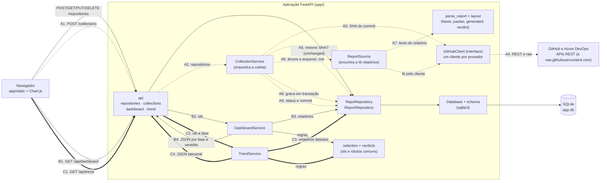

# Diagrama de componentes e fluxo de dados

Componentes da aplicação como estão implementados (veja [01 escopo-mvp.md](01%20escopo-mvp.md) para os requisitos). Há três fluxos:

- **Coleta** (linhas tracejadas, A1–A9): lê o GitHub e grava no banco. É o único fluxo que acessa o GitHub.
- **Dashboard** (linhas contínuas, B1–B4): lê só o banco.
- **Tendência** (linhas grossas, C1–C4): lê só o banco.

**Pontos de projeto**
- O dashboard e a tendência nunca chamam o GitHub; só a coleta chama, o que mantém a cota da API sob controle.
- A coleta lê todos os arquivos pelo SHA do commit (A3), então os dados são um retrato único dele. Com `only_if_changed`, o mesmo SHA da última coleta bem-sucedida encerra o fluxo em A5, sem ler arquivos.
- `GitHubClient` é uma interface: o serviço de coleta escolhe o cliente pelo provedor do repositório (GitHub ou Azure DevOps). As versões HTTP são usadas em produção e a versão em memória, nos testes.
- A gravação (A8) troca todos os relatórios do repositório em uma única transação; se falhar, os dados anteriores permanecem.
