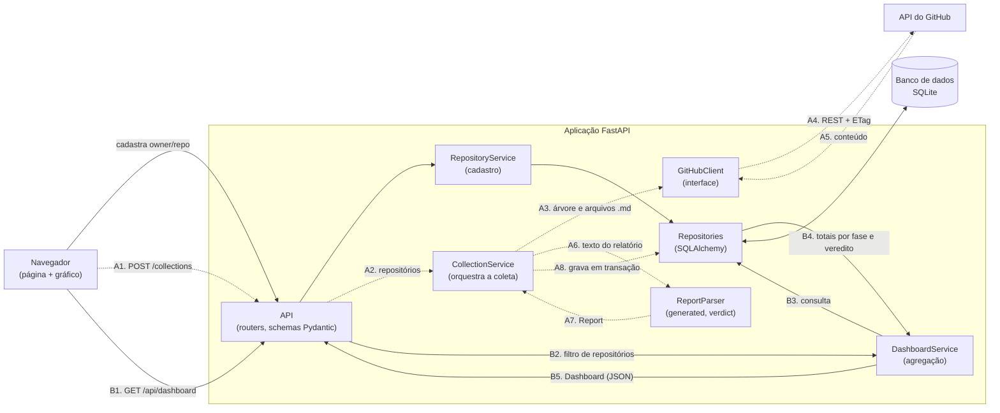

# Diagrama de componentes e fluxo de dados

Componentes do MVP descritos em [01 escopo-mvp.md](01%20escopo-mvp.md). Dois fluxos: **coleta** (linhas tracejadas, A1–A8) e **consulta ao dashboard** (linhas contínuas, B1–B5).

